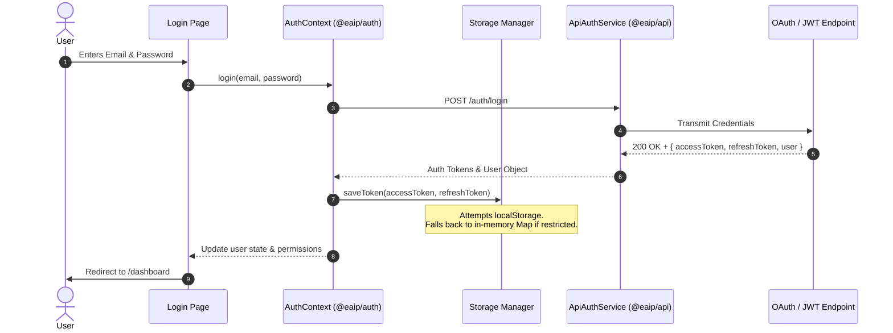

# FRONTEND ARCHITECTURE MAP
**EAIP Frontend — Monorepo Architectural Topology**
**Version**: v1.0.0-rc1
**Date**: August 7, 2026

---

## 1. Monorepo Package Graph

```mermaid
graph TD
    subgraph Applications
        EC[enterprise-console]
        WS[workspace]
        MC[mission-control]
        ADM[administration]
        MOB[mobile]
    end

    subgraph "Enterprise UI Packages"
        UIE[@eaip/ui-enterprise]
        UIV[@eaip/ui-visualizations]
        UIF[@eaip/ui-foundation]
        UIP[@eaip/ui-primitives]
    end

    subgraph "Core Infrastructure & Domain Packages"
        AUTH[@eaip/auth]
        API[@eaip/api]
        STATE[@eaip/state]
        MOT[@eaip/motion]
        TOK[@eaip/design-tokens]
        THM[@eaip/theme]
        TYP[@eaip/typography]
        ICO[@eaip/icons]
        KNOW[@eaip/knowledge]
        WF[@eaip/workflow]
        AGT[@eaip/agent]
    end

    Applications --> UIE
    UIE --> UIV
    UIE --> UIF
    UIF --> UIP
    UIP --> TYP
    UIP --> TOK
    UIP --> ICO
    Applications --> AUTH
    Applications --> API
    Applications --> STATE
    UIE --> MOT
    AUTH --> API
```

---

## 2. Authentication Lifecycle Topology



---

## 3. Provider Stack Order

```
┌────────────────────────────────────────────────────────┐
│ <ThemeProvider> (@eaip/theme)                           │
│   ┌────────────────────────────────────────────────────┐
│   │ <AuthProvider> (@eaip/auth)                        │
│   │   ┌────────────────────────────────────────────────┐
│   │   │ <FallbackProvider> (services/fallback-context) │
│   │   │   ┌────────────────────────────────────────────┐
│   │   │   │ <ToastContainer /> (@eaip/ui-foundation)   │
│   │   │   │   ┌────────────────────────────────────────┐
│   │   │   │   │ <GlobalSearchDialog />                 │
│   │   │   │   │   ┌────────────────────────────────────┐
│   │   │   │   │   │ <AppRouter> (Next.js Application)  │
│   │   │   │   │   └────────────────────────────────────┘
│   │   │   │   └────────────────────────────────────────┘
│   │   │   └────────────────────────────────────────────┘
│   │   └────────────────────────────────────────────────┘
│   └────────────────────────────────────────────────────┘
└────────────────────────────────────────────────────────┘
```

---

## 4. Navigation Topology & Workspace Switching

```
                              ┌──────────────────────┐
                              │ GlobalSearch (⌘K)    │
                              └──────────┬───────────┘
                                         │
                   ┌─────────────────────┴─────────────────────┐
                   │                                           │
         ┌─────────▼────────┐                         ┌────────▼─────────┐
         │ Enterprise App   │                         │  Workspace App   │
         │ Switcher Dropdown│                         │  (Port 3001)     │
         └─────────┬────────┘                         └──────────────────┘
                   │
    ┌──────────────┼──────────────┬──────────────┐
    │              │              │              │
┌───▼──┐       ┌───▼──┐       ┌───▼──┐       ┌───▼──┐
│Console│       │Workspace│    │Mission│      │ Admin│
│(3000) │       │(3001)   │    │(3002) │      │(3003)│
└───────┘       └─────────┘    └───────┘      └──────┘
```
